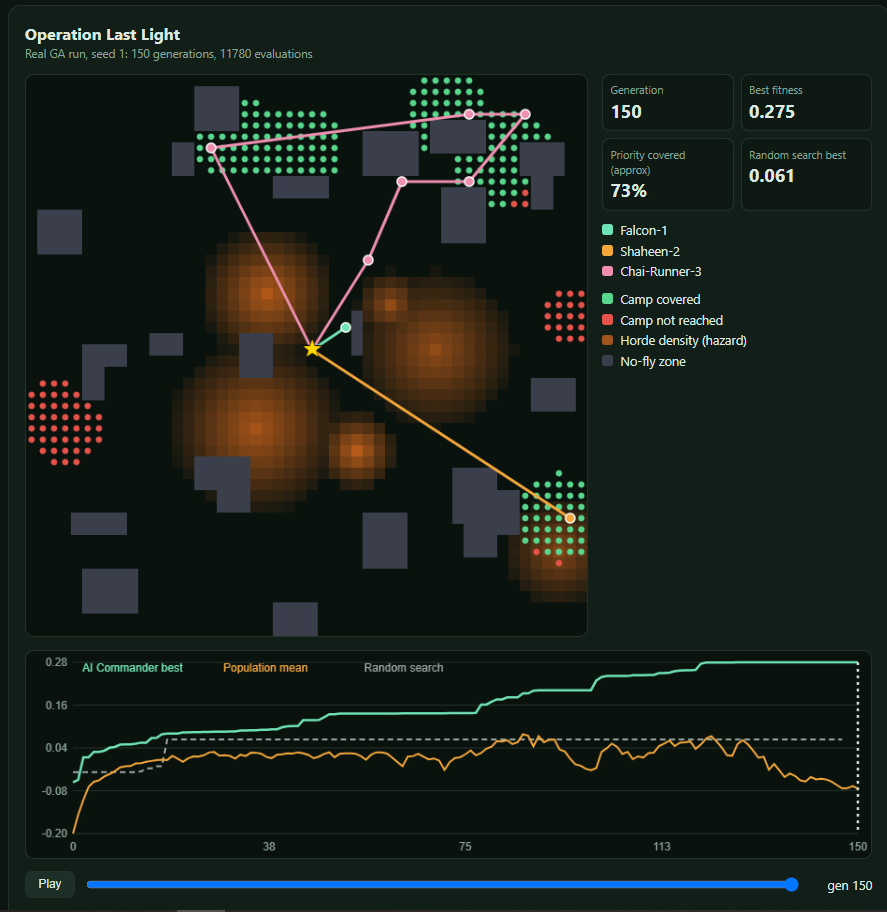
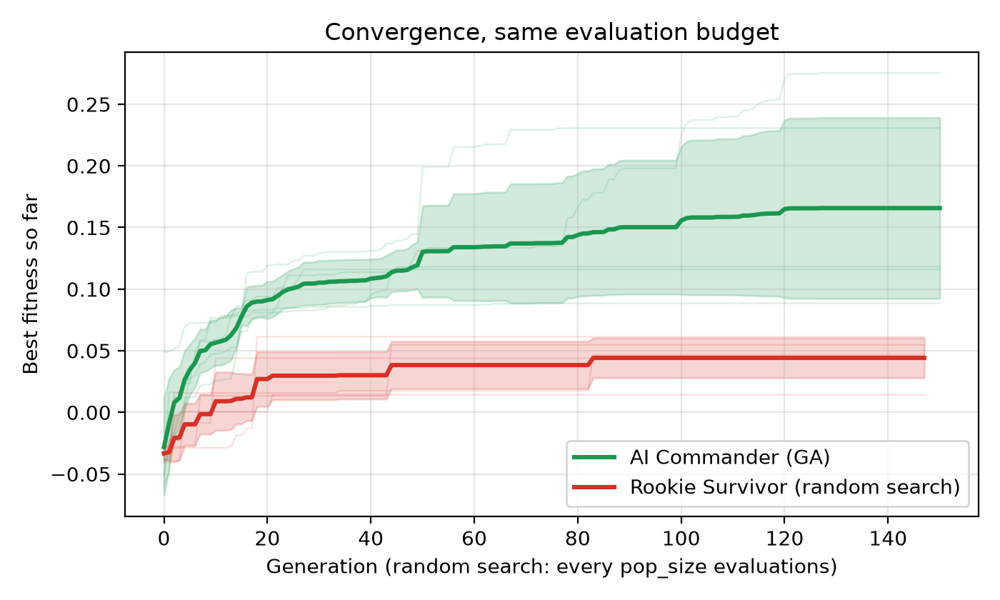

# Operation Last Light

A Genetic Algorithm "Strategy Engine" that plans routes for a fleet of UAVs over a hazard grid. Zombie-outbreak theme: hordes are hazards, survivor camps are priority cells, the drones are the fleet, and the **AI Commander** (the GA) tries to find the best plan. A **Rookie Survivor** (random search with the same budget) is the baseline.

AI Assignment 2, BSCS 5, Bahria University Lahore. Solo project/Assignment CCP.



## What it does

Given a 50 x 50 map with hazard, priority cells, no-fly zones and a depot, the GA evolves plans for 3 drones that:

- maximise coverage and detection of priority cells
- minimise energy, mission time and hazard exposure
- never enter no-fly zones or exceed the flight range

Each chromosome is a fleet plan: per drone, 1 to 10 waypoints, each with a position, speed and sensor power.

## Results (map seed 7, 5 GA seeds)

| | Mean fitness | Std |
| --- | --- | --- |
| AI Commander (GA) | 0.166 | 0.073 |
| Rookie Survivor (random, same budget) | 0.044 | 0.016 |



The GA is about 3.8x better than random search and wins on every seed. Best run: 0.275. Full analysis, sensitivity study (population size, mutation rate, tournament size) and discussion are in the report.

## Project structure

```
operation-last-light/
  uav_ga/
    environment.py     map: hazard, priority, no-fly layers, depot
    chromosome.py      Gene, DronePlan, FleetChromosome
    fitness.py         Evaluator and weights loader
    operators.py       selection, crossover, mutation, repair
    ga.py              Hyperparameters, GAResult, run_ga()
    baseline.py        random-search baseline
    visualize.py       convergence, routes, coverage heatmaps
  config/
    default_weights.yaml
  experiments/
    run_sensitivity.py hyperparameter sweep
  tests/
  main.py              run the GA
  make_figures.py      GA vs random + figures
  results/             plots, CSVs, dashboard.html
```

## Installation

```
git clone <https://github.com/dani70-cyber/operation-last-light.git>
cd operation-last-light
pip install -r requirements.txt
```

Python 3.10 or newer is recommended.

## Usage

Run the GA on 5 seeds:

```
python main.py --seeds 5 --generations 150
```

Generate the figures and the GA vs random comparison:

```
python make_figures.py --seeds 5 --generations 150 --out results
```

Outputs: `results/convergence.png`, `best_routes.png`, `coverage_heatmaps.png`, `ga_vs_random.csv`.

Run the sensitivity study (27 runs; use `--quick` first for a smoke test):

```
python experiments/run_sensitivity.py
```

Outputs: `results/sensitivity_raw.csv`, `results/sensitivity_summary.csv`.

Open the replay dashboard:

```
start results/dashboard.html
```

Run the tests:

```
pytest
```

## Fitness function

```
F = 0.30 coverage + 0.25 detection - 0.15 energy - 0.10 time
    - 0.20 hazard - 1.0 no-fly - 0.5 range
```

Weights live in `config/default_weights.yaml`.

## Default hyperparameters

Population 80, 150 generations, elite 2, tournament size 3, crossover rate 0.9, mutation rate 0.12, 5% random immigrants, early stop after 60 stagnant generations. Seeds are fixed, so results are reproducible.

## Known limitations

- All experiments use one map (seed 7), one depot and one range setting.
- High variance across seeds (premature convergence).
- One drone tends to do most of the coverage.
- Fitness weights are hand-chosen.

## Made By

Muhammad Daniyal Nasir, BSCS, Bahria University Lahore.